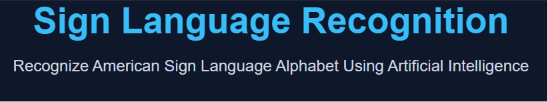
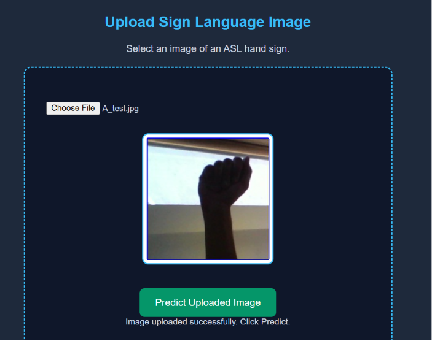
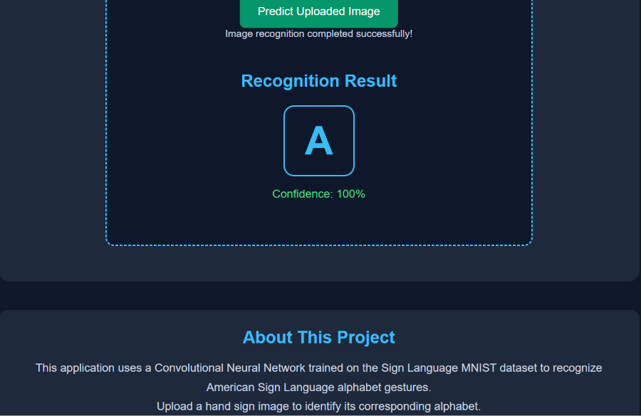
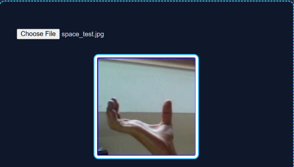
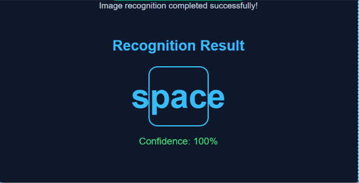
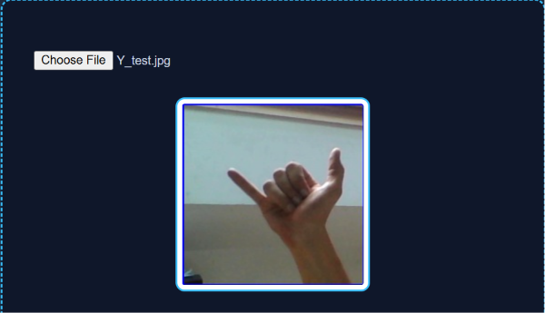
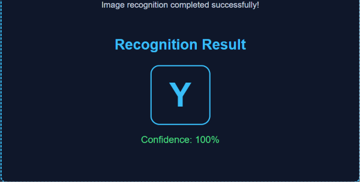

# ASL Sign Language Recognition Using CNN

An AI-powered web application that recognizes American Sign Language (ASL) alphabet gestures from uploaded hand images using a Convolutional Neural Network (CNN).

The application allows users to upload an image of a hand sign and predicts the corresponding alphabet or sign along with its confidence score.

## Project Overview

Sign language is an important communication method for people with hearing and speech impairments. This project aims to make sign language recognition easier by using Deep Learning and Computer Vision techniques.

The system uses a trained CNN model to classify uploaded hand gesture images into 29 categories, including:

- 26 English alphabets (A–Z)
- Delete
- Nothing
- Space

## Key Features

- **Image Upload:** Upload hand gesture images through a web interface.
- **ASL Recognition:** Recognizes ASL alphabet signs using a CNN model.
- **29-Class Classification:** Supports letters A–Z, Delete, Nothing, and Space.
- **Confidence Score:** Displays the prediction confidence percentage.
- **Image Preview:** Displays the selected image before prediction.
- **Interactive Web Interface:** Simple and user-friendly interface built using Flask, HTML, CSS, and JavaScript.

## Technologies Used

| Category | Technologies |
|---|---|
| Programming Language | Python |
| Deep Learning | TensorFlow, CNN |
| Image Processing | OpenCV |
| Data Processing | NumPy, Pandas |
| Machine Learning | Scikit-learn |
| Web Framework | Flask |
| Frontend | HTML, CSS, JavaScript |
| Development Tools | VS Code, Jupyter Notebook |

## Dataset

**Dataset:** ASL Alphabet Dataset

The dataset contains images representing the 26 English alphabets and three additional classes:

- A–Z
- Delete
- Nothing
- Space

The dataset is organized into separate folders based on their corresponding classes and is used to train the CNN model.

## Project Structure

```text
ASL-Sign-Language-Recognition-Using-CNN/
│
├── dataset/
│   ├── sign_mnist_train.csv
│   └── sign_mnist_test.csv
│
├── asl_alphabet_dataset/
│   ├── asl_alphabet_train/
│   └── asl_alphabet_test/
│
├──├── screenshots/
│   ├── home.png
│   ├── a_sign_upload.png
│   ├── a_sign_predict.png
│   ├── space_sign_upload.png
│   ├── space_sign_predict.png
│   ├── y_sign_upload.png
│   └── y_sign_predict.png
│
├── static/
│   ├── style.css
│   └── script.js
│
├── templates/
│   └── index.html
│
├── app.py
├── train_cnn_model.py
├── test_cnn_model.py
├── class_names.txt
├── sign_language_cnn_29.keras
├── requirements.txt
├── .gitignore
├── MNIST_sign.ipynb
└── README.md
```

## Application Screenshots

### 1. Home Page


### 2. Letter A – Image Upload


### 3. Letter A – Recognition Result


### 4. Space Sign – Image Upload


### 5. Space Sign – Recognition Result


### 6. Letter Y – Image Upload


### 7. Letter Y – Recognition Result


## Installation and Setup

### Step 1: Clone the Repository

```bash
git clone https://github.com/NavyaRocky02/ASL-Sign-Language-Recognition-Using-CNN.git
```

### Step 2: Open the Project Folder

```bash
cd ASL-Sign-Language-Recognition-Using-CNN
```

### Step 3: Create a Virtual Environment

```bash
python -m venv venv
```

### Step 4: Activate the Virtual Environment

For Windows PowerShell:

```bash
venv\Scripts\Activate.ps1
```

### Step 5: Install Dependencies

```bash
pip install -r requirements.txt
```

### Step 6: Run the Application

```bash
python app.py
```

### Step 7: Open the Web Application

Open your browser and visit:

```text
http://127.0.0.1:5000
```

## How to Use

1. Open the Sign Language Recognition web application.
2. Click the **Choose File** button.
3. Select an ASL hand gesture image.
4. Preview the uploaded image.
5. Click **Predict Uploaded Image**.
6. View the recognized alphabet or sign.
7. Check the prediction confidence percentage.

## Model Information

- **Model:** Convolutional Neural Network (CNN)
- **Framework:** TensorFlow / Keras
- **Input Image Size:** 64 × 64 pixels
- **Input Channels:** RGB (3 channels)
- **Number of Classes:** 29
- **Output:** Predicted sign and confidence score

## Future Enhancements

- Real-time sign language recognition using a webcam.
- Recognition of complete words and sentences.
- Video-based recognition of dynamic signs.
- Support for additional sign languages.
- Improved model performance on real-world images.

## Author

**Navya Sree Challa**

B.Tech – Computer Science and Artificial Intelligence

## GitHub Repository

[ASL Sign Language Recognition Using CNN](https://github.com/NavyaRocky02/ASL-Sign-Language-Recognition-Using-CNN)

---

⭐ If you find this project useful, consider giving the repository a star!
